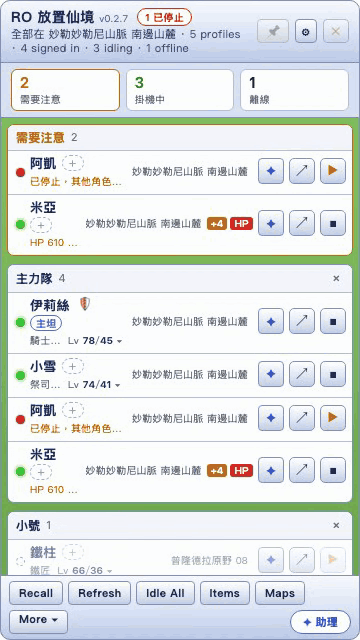
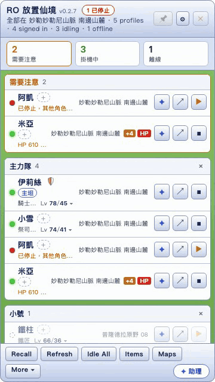
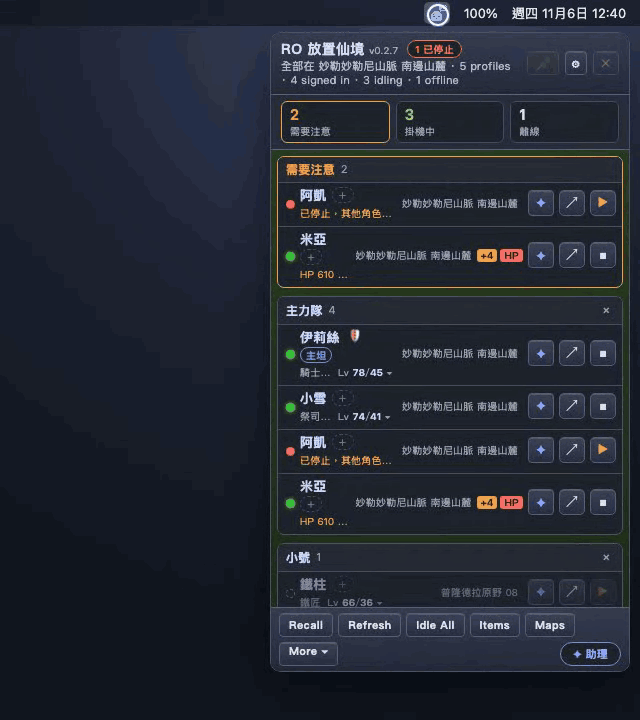
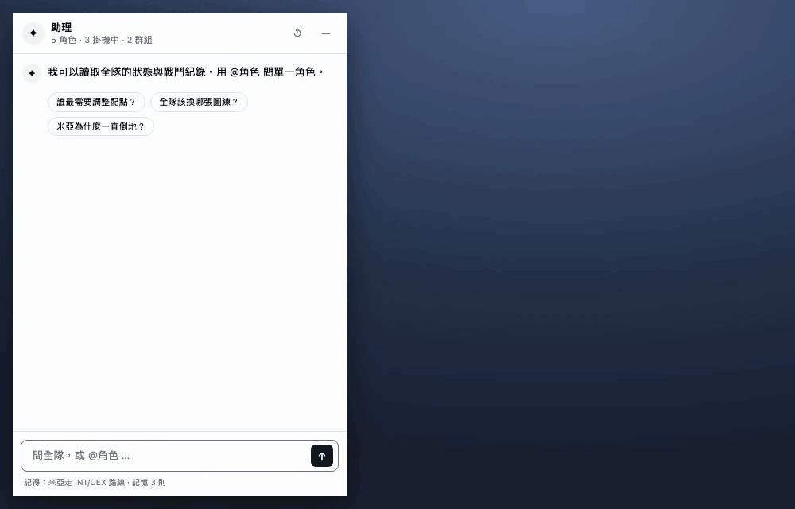
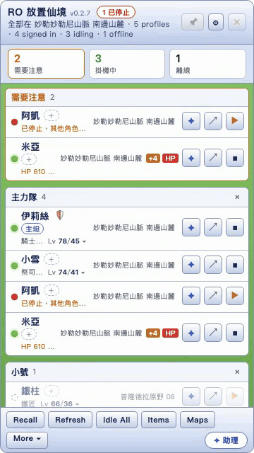
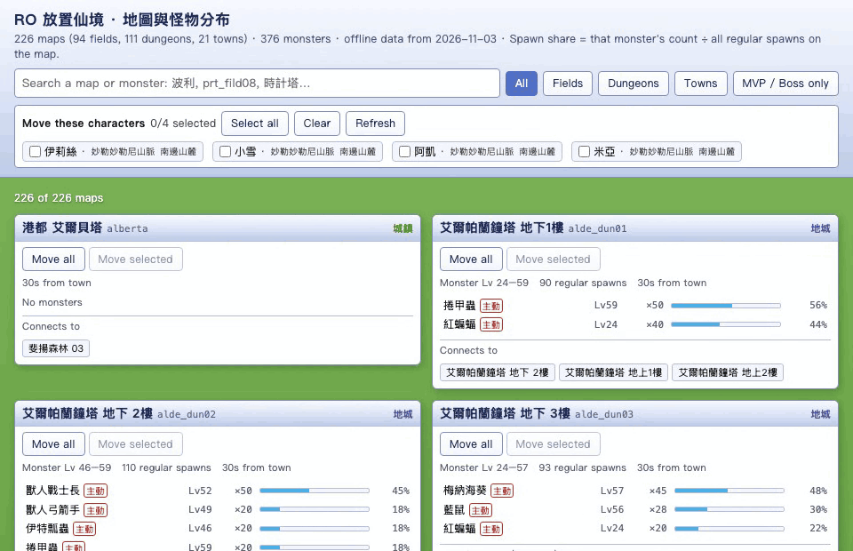
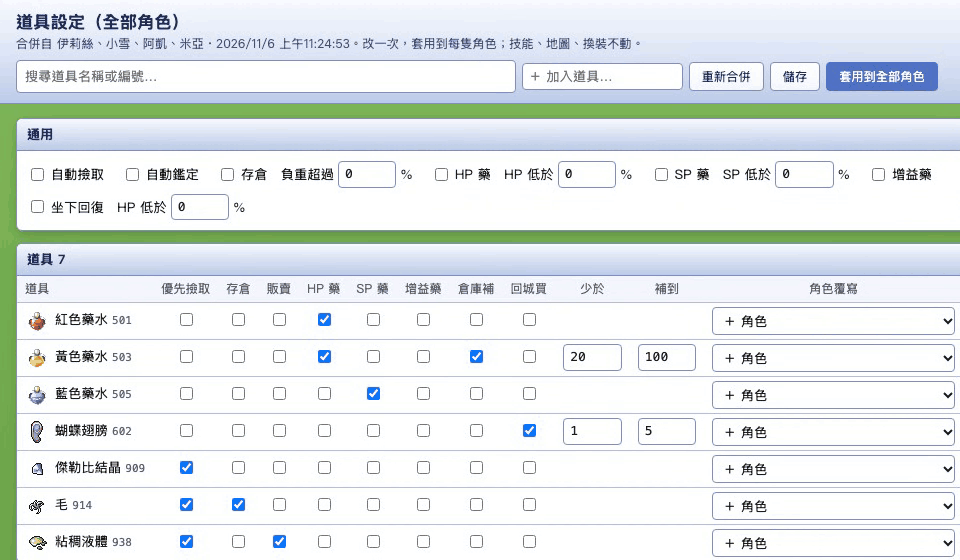
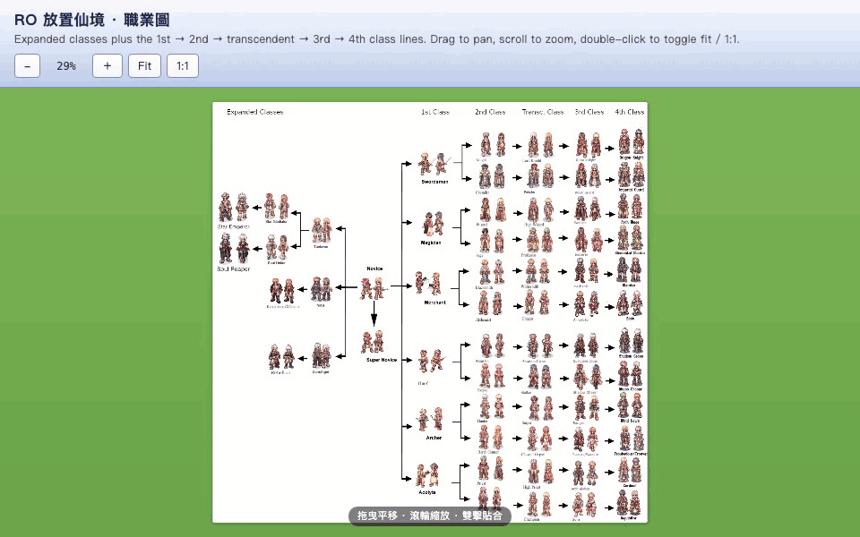
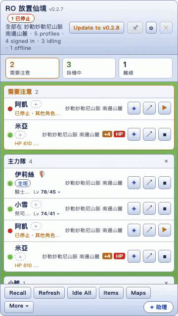
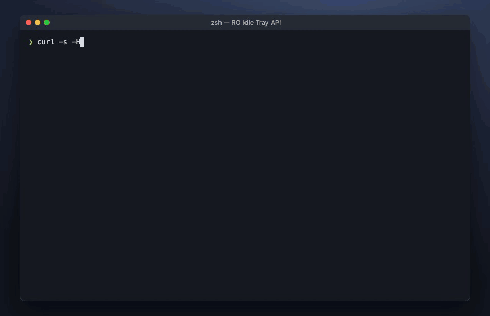

<div align="center">


# RO Idle Tray

[](https://github.com/mike623/ro-idle-tray/releases/latest)

[](https://tauri.app)

macOS menu-bar companion for [ro-idle.app](https://ro-idle.app/): run several accounts side by side, watch every character from one panel, and ask an AI assistant that knows the game data.

**English** · [繁體中文](README.zh-TW.md) · [Website](https://mike623.github.io/ro-idle-tray/)

[Features](#features) • [Install](#install) • [Development](#development) • [References](#references) • [Release](#release)


</div>

The game stays hosted remotely and sign-in stays with the site. The tray wraps it in isolated WebViews, reads what the page already loads, and adds tools on top.

## Features

> [!NOTE]
> Every clip below is recorded by `e2e/record.mjs` from the app's own windows, with made-up characters.

| | |
|---|---|
| **Character panel.** Every character across every account in one list: Base/Job level, map, HP/SP, EXP. Characters needing attention float up (stopped while others idle, HP under 25%, too heavy). Hover for details, filter by status, group and drag to reorder, add nicknames and a job goal. |  |
| **Bulk actions.** Idle All / Stop All, and Recall everyone to their save point (asks once first). |  |
| **Assist & lure modes.** Right-click a character: **輔助模式** sets every monster on the map to fight back only when hit (🛡); **拉怪模式** pulls them all (🧲). Both re-apply after each map change. |  |
| **AI assistant (助理).** Its own window; `@角色` scopes a question. Reads live state, battle logs, skills and game data, lists every lookup, and stat/skill suggestions apply to the game's 自動配點 with one confirmed click. Keeps an editable Markdown memory; short lessons pop up when the log shows a real problem. |  |
| **Guides to follow.** 📖 pins up to three guides from [ned-lin-9527.github.io/Ragnarok](https://ned-lin-9527.github.io/Ragnarok/) plus your own note to a character; ↗ opens a guide in its own window. |  |
| **Any model.** Any Anthropic- or OpenAI-compatible endpoint, by default a local [CLIProxyAPI](https://github.com/router-for-me/CLIProxyAPI). Live model list with detected context size; Test connection also checks prompt caching. |  |
| **Map & monster atlas.** All maps and spawns offline; search a monster to rank maps by its spawn share, with aggressive/boss/MVP tags. Move all or selected characters there with the game's own map command. |  |
| **Item settings editor.** Every character's 道具設定 (loot, storage, sell, potions, restock) merged into one table, with per-character overrides; apply to all. |  |
| **Class chart.** Novice to 4th class on one zoomable, draggable chart. |  |
| **Hands-off upkeep.** Offline characters keep their last data and wake hourly; Refresh wakes them all now. A new release shows an `Update to vX.Y.Z` button (checked on launch and every 6 h); nothing installs until you click. |  |
| **Local read-only API.** `http://127.0.0.1:47615` behind a bearer token: `/characters`, `/characters/:name`, `…/log`, `…/summary`. |  |

Each profile also has its own WebView data directory, so Google sign-ins never mix, and API keys are encrypted at rest and never reach the game windows. Web search (optional) goes through Tavily's hosted MCP server, search and extract only.

## Install

Download the `.dmg` from [Releases](https://github.com/mike623/ro-idle-tray/releases/latest).

> [!IMPORTANT]
> The build is not Apple-signed or notarized. The first time, right-click the app › **Open** › **Open**.

## Development

**Requirements:** macOS, [Node.js](https://nodejs.org/), and the [Rust toolchain](https://rustup.rs/) (see [Tauri prerequisites](https://tauri.app/start/prerequisites/)).

```sh
npm install
npm run tauri dev
```

Run the tests:

```sh
node --test
cargo test --manifest-path src-tauri/Cargo.toml
```

Build a release bundle (output: `src-tauri/target/release/bundle/macos/ro-idle-tray.app`):

```sh
npm run tauri build
```

> [!TIP]
> Dev builds record raw API traffic to `<app config>/capture/*.jsonl` (`src/capture.js`; auth calls are never recorded). `scripts/capture-gaps.py` and `scripts/formula-check.py` analyse those captures for the offline-backend work in [`docs/offline-backend`](docs/offline-backend).

### Demo recordings

`e2e/record.mjs` drives the app's own windows in headless Chromium with a mocked Tauri bridge (`e2e/mock-tauri.js`, made-up data) and writes one GIF per feature to `site/media/`. Needs `ffmpeg` and, once, `npx playwright install chromium-headless-shell`.

```sh
node e2e/record.mjs          # all scenes
node e2e/record.mjs atlas    # one scene
```

The landing page is `site/index.html` (English / 繁體中文); `.github/workflows/pages.yml` publishes `site/` to GitHub Pages on every push to `main` that touches it.

### Project layout

| Path | Contents |
|------|----------|
| `src/` | Panel, assistant, atlas, item editor and class chart windows (plain HTML/JS), plus the game-page hooks |
| `src-tauri/src/` | Rust backend: tray and windows (`lib.rs`), chat and AI provider, knowledge tools, alerts, local API, encrypted secrets |
| `scripts/extract-maps.mjs` | Extracts monsters, maps, skills and items from the game bundle into `src/game-data.json` / `src/item-info.json` |
| `tests/` | Node test suites for the frontend helpers |
| `e2e/`, `site/` | Demo recorder and the GitHub Pages landing page |

## References

Game sources used by the tray, the assistant, and the offline-backend work:

- [ro-idle.app/info](https://ro-idle.app/info) — official site: [更新紀錄](https://ro-idle.app/info/updates), [新手指南](https://ro-idle.app/info/guide), [玩法與公式](https://ro-idle.app/info/mechanics) (stat, damage, HIT/FLEE, ASPD, cast, regen, death, offline-settlement rules "from the game's actual code"), [資料查詢](https://ro-idle.app/info/database).
- Game bundle `https://ro-idle.app/assets/index-*.js` — static data literal (monsters, maps, skills, items) extracted by `scripts/extract-maps.mjs` into `src/game-data.json` / `src/item-info.json`; also the client API surface (`/api/characters/:id/{commands,stream,events,...}`).
- [ned-lin-9527.github.io/Ragnarok](https://ned-lin-9527.github.io/Ragnarok/) ([repo](https://github.com/ned-lin-9527/Ragnarok)) — player guides and dated skill-tree / equipment data dumps; read live by `src-tauri/src/guide.rs`.
- [nba9001-sys/ro-idle](https://github.com/nba9001-sys/ro-idle) — a different, client-only RO idle game (諸神放置錄). Not ro-idle.app; useful only as a reference simulation engine.
- [iRO Wiki Classic](https://irowiki.org/classic/) — pre-renewal mechanics. ro-idle.app names it and rAthena as its sources ("遊戲數值參考 rAthena 開源專案與 iRO Wiki Classic 的公開資料"); its homunculus help also says "原版 pre-re". Explains mechanics in plain language; where it differs from rAthena (e.g. player soft DEF), captures side with rAthena — always verify.
- [Ragnarok Research Lab](https://ragnarokresearchlab.github.io/community-projects/) — index of RO server emulators. They speak the original RO packet protocol, not ro-idle.app's HTTP/SSE API, so they are formula references only (damage pipeline order, DEF, rounding); always verify against captures, since ro-idle.app says its rules differ from other RO versions.
  - [rAthena](https://github.com/rathena/rathena) / [Hercules](https://github.com/HerculesWS/Hercules) — GPL-3.0: read for reference, don't copy code.
  - [rust-ro](https://github.com/nmeylan/rust-ro) — MIT, Rust; battle/status code can be reused with attribution.

## Release

Version source of truth: `src-tauri/tauri.conf.json` `version`. Keep `src-tauri/Cargo.toml` and `package.json` equal to it.

1. Bump the version in those 3 files.
2. Commit.
3. `git tag vX.Y.Z && git push && git push --tags`

`.github/workflows/release.yml` checks the tag matches `tauri.conf.json`, builds a universal macOS app, and publishes the `.dmg`, `.app.tar.gz`, `.sig` and `latest.json` (the updater feed) to the GitHub Release.

> [!WARNING]
> Updates are signed with the key in `~/.tauri/ro-idle-tray.key`, stored as the `TAURI_SIGNING_PRIVATE_KEY` repo secret; the public half is in `tauri.conf.json`. Losing the private key means existing installs can no longer auto-update.
