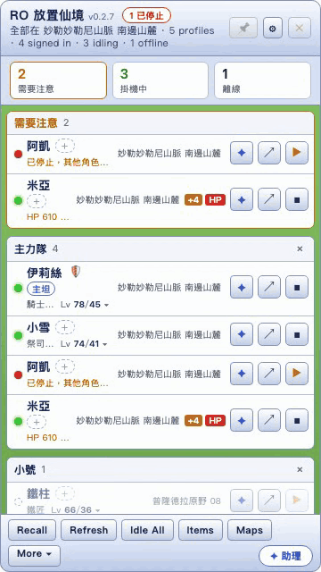
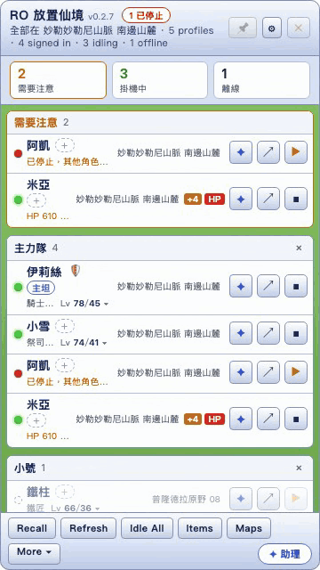
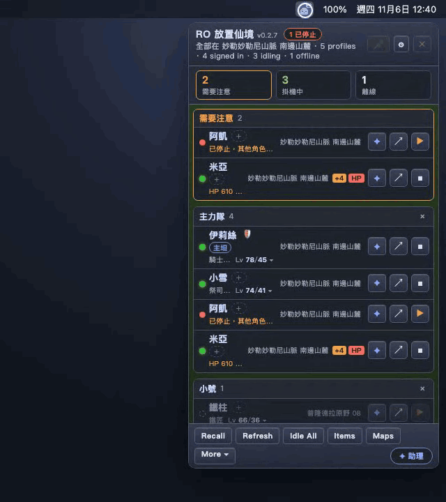
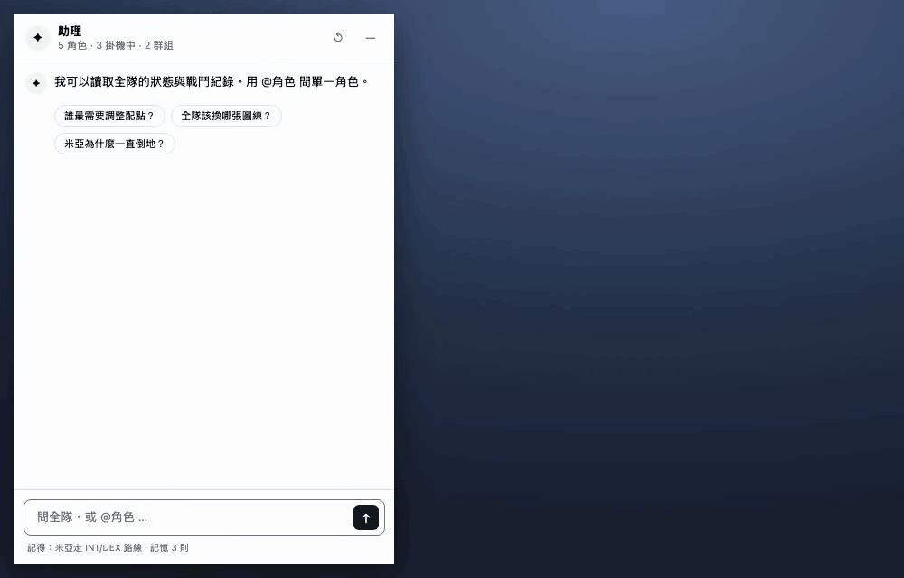
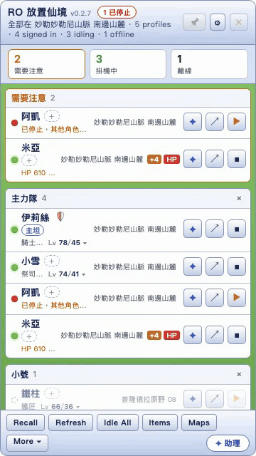
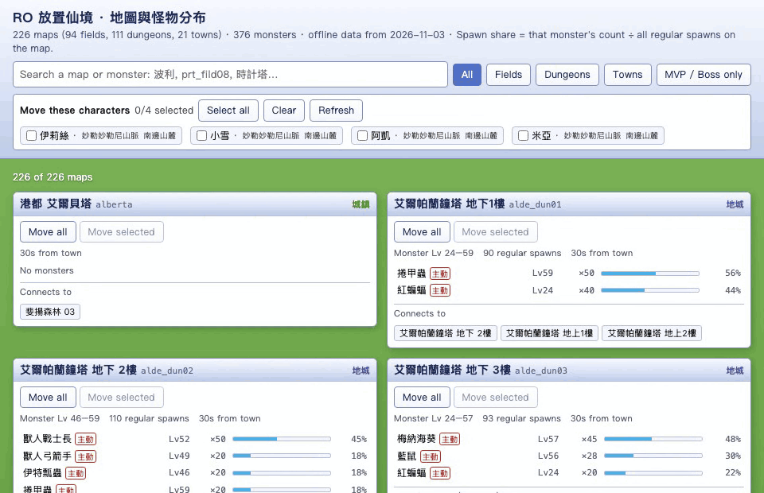
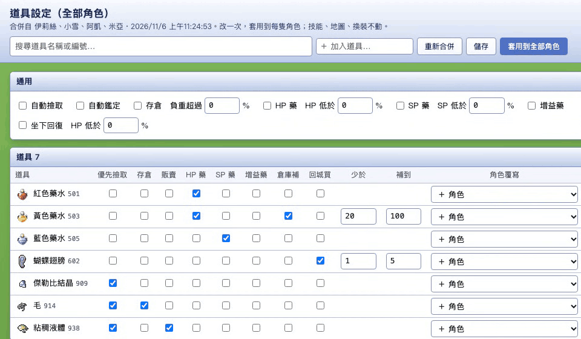
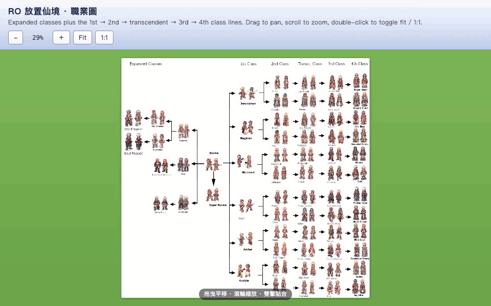
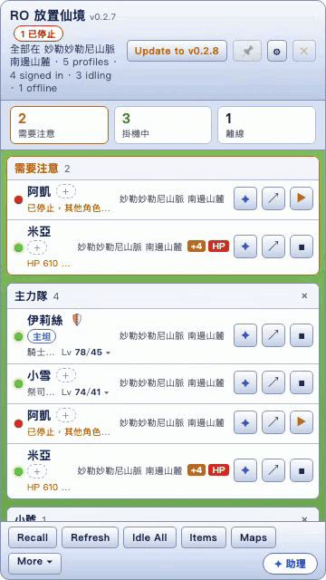
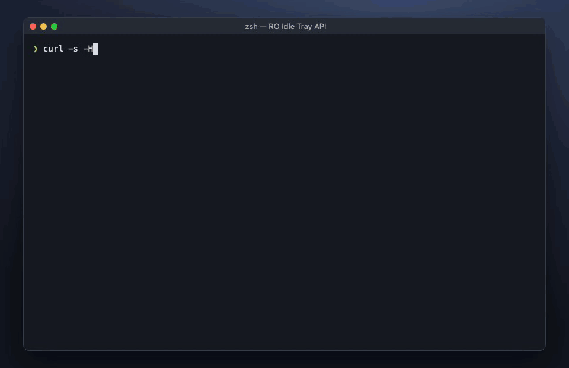

<div align="center">


# RO Idle Tray

[](https://github.com/mike623/ro-idle-tray/releases/latest)

[](https://tauri.app)

[RO 放置仙境 ro-idle.app](https://ro-idle.app/) 的 macOS 選單列小幫手：多帳號同時掛機、一個面板看全部角色，還有懂遊戲資料的 AI 助理。

[English](README.md) · **繁體中文** · [官方網站](https://mike623.github.io/ro-idle-tray/)

[功能](#功能) • [安裝](#安裝) • [開發](#開發) • [參考資料](#參考資料) • [發佈版本](#發佈版本)


</div>

遊戲仍在 ro-idle.app 上執行，登入也由網站處理。本程式用彼此隔離的 WebView 包住遊戲頁面，讀取頁面本來就會載入的資料，再加上各種工具。

## 功能

> [!NOTE]
> 以下每段動畫都由 `e2e/record.mjs` 從程式本身的視窗錄製，角色資料皆為虛構。

| | |
|---|---|
| **角色面板**：所有帳號、所有角色一張清單，顯示 Base/Job 等級、地圖、HP/SP、經驗值。需要注意的角色會浮到最上面（別人在掛機它卻停了、HP 低於 25%、負重過重）。游標移上去看詳細，可依狀態篩選、分群組、拖曳排序、加暱稱與職業方向。 |  |
| **一鍵全隊**：Idle All／Stop All，以及 Recall 讓全員回儲存點（執行前先確認一次）。 |  |
| **輔助模式與拉怪模式**：在角色上按右鍵。**輔助模式**把本圖所有怪物設為「被打才還手」（🛡）；**拉怪模式**則全部引怪（🧲）。換圖後自動重新套用。 |  |
| **AI 助理**：獨立視窗，輸入 `@角色` 只問那一隻。會讀角色即時狀態、戰鬥紀錄、技能與遊戲資料，列出查了哪些資料；配點與技能建議確認後一鍵寫入遊戲的「自動配點」。有可編輯的 Markdown 記憶；戰鬥紀錄出現實際問題時會跳出簡短教學。 |  |
| **跟隨攻略**：用 📖 替角色釘選最多三篇 [ned-lin-9527.github.io/Ragnarok](https://ned-lin-9527.github.io/Ragnarok/) 的攻略，再加上自己的指示；按 ↗ 在獨立視窗開啟攻略。 |  |
| **任選模型**：任何相容 Anthropic 或 OpenAI 的端點，預設是本機的 [CLIProxyAPI](https://github.com/router-for-me/CLIProxyAPI)。即時模型清單、自動偵測上下文長度；Test connection 也會檢查提示快取。 |  |
| **地圖與怪物分布**：離線收錄全部地圖與怪物分布；搜尋怪物，地圖依出現比例排序，並標出主動怪／BOSS／MVP。用遊戲本身的移動指令，把全部或選取的角色送過去。 |  |
| **道具設定**：把每隻角色的道具設定（撿取、存倉、販賣、喝水、補貨）合併成一張表，可個別角色覆寫，再一次套用到全部。 |  |
| **職業圖**：從初學者到四轉，一張可縮放、可拖曳的職業圖。 |  |
| **自動維護**：離線角色保留最後的資料，每小時自動喚醒；Refresh 立刻全部喚醒。有新版本時出現 `Update to vX.Y.Z` 按鈕（啟動時與每 6 小時檢查），按下去才安裝。 |  |
| **本機唯讀 API**：`http://127.0.0.1:47615`，需要 bearer token：`/characters`、`/characters/:name`、`…/log`、`…/summary`。 |  |

每個設定檔都有獨立的 WebView 資料夾，Google 登入不會混在一起；API 金鑰加密存在本機，遊戲視窗拿不到。網路搜尋（選用）透過 Tavily 的 MCP 伺服器，只開放搜尋與擷取網頁。

## 安裝

從 [Releases](https://github.com/mike623/ro-idle-tray/releases/latest) 下載 `.dmg`。

> [!IMPORTANT]
> 程式未經 Apple 簽署或公證。第一次開啟請在 App 上按右鍵 › **打開** › **打開**。

## 開發

**需求：** macOS、[Node.js](https://nodejs.org/)、[Rust 工具鏈](https://rustup.rs/)（見 [Tauri 前置需求](https://tauri.app/start/prerequisites/)）。

```sh
npm install
npm run tauri dev
```

執行測試：

```sh
node --test
cargo test --manifest-path src-tauri/Cargo.toml
```

建置發佈版（輸出：`src-tauri/target/release/bundle/macos/ro-idle-tray.app`）：

```sh
npm run tauri build
```

> [!TIP]
> 開發版會把 API 原始流量記錄到 `<app config>/capture/*.jsonl`（`src/capture.js`；登入相關請求一律不記錄）。`scripts/capture-gaps.py` 與 `scripts/formula-check.py` 用這些紀錄分析離線後端，見 [`docs/offline-backend`](docs/offline-backend)。

### 示範動畫

`e2e/record.mjs` 用無頭 Chromium 操作程式本身的視窗，Tauri 介面以 `e2e/mock-tauri.js`（虛構資料）代替，每個功能輸出一個 GIF 到 `site/media/`。需要 `ffmpeg`，第一次另需 `npx playwright install chromium-headless-shell`。

```sh
node e2e/record.mjs          # 全部
node e2e/record.mjs atlas    # 單一場景
```

官方網站是 `site/index.html`（English／繁體中文）；`.github/workflows/pages.yml` 在 `main` 上有改到 `site/` 時發佈到 GitHub Pages。

### 專案結構

| 路徑 | 內容 |
|------|------|
| `src/` | 面板、助理、地圖、道具設定、職業圖等視窗（純 HTML/JS），以及遊戲頁面的掛勾 |
| `src-tauri/src/` | Rust 後端：選單列與視窗（`lib.rs`）、對話與 AI 服務、知識查詢工具、提醒、本機 API、加密金鑰 |
| `scripts/extract-maps.mjs` | 從遊戲程式碼擷取怪物、地圖、技能、道具到 `src/game-data.json`／`src/item-info.json` |
| `tests/` | 前端輔助函式的 Node 測試 |
| `e2e/`、`site/` | 示範動畫錄製程式與 GitHub Pages 官方網站 |

## 參考資料

選單列程式、助理與離線後端所用的遊戲資料來源：

- [ro-idle.app/info](https://ro-idle.app/info)：官方網站，含[更新紀錄](https://ro-idle.app/info/updates)、[新手指南](https://ro-idle.app/info/guide)、[玩法與公式](https://ro-idle.app/info/mechanics)（屬性、傷害、HIT/FLEE、ASPD、詠唱、回復、死亡、離線結算，標明「來自遊戲實際程式碼」）、[資料查詢](https://ro-idle.app/info/database)。
- 遊戲程式 `https://ro-idle.app/assets/index-*.js`：內含怪物、地圖、技能、道具的靜態資料，由 `scripts/extract-maps.mjs` 擷取到 `src/game-data.json`／`src/item-info.json`；也是用戶端 API 的來源（`/api/characters/:id/{commands,stream,events,...}`）。
- [ned-lin-9527.github.io/Ragnarok](https://ned-lin-9527.github.io/Ragnarok/)（[repo](https://github.com/ned-lin-9527/Ragnarok)）：玩家攻略與標註日期的技能樹／裝備資料，由 `src-tauri/src/guide.rs` 即時讀取。
- [nba9001-sys/ro-idle](https://github.com/nba9001-sys/ro-idle)：另一款純前端的 RO 放置遊戲（諸神放置錄），不是 ro-idle.app，只能當模擬引擎參考。
- [iRO Wiki Classic](https://irowiki.org/classic/)：pre-renewal 機制。ro-idle.app 註明數值參考它與 rAthena（「遊戲數值參考 rAthena 開源專案與 iRO Wiki Classic 的公開資料」），生命體說明也寫「原版 pre-re」。說明淺白；與 rAthena 不同之處（例如玩家軟防禦），實測結果站在 rAthena 這邊，務必驗證。
- [Ragnarok Research Lab](https://ragnarokresearchlab.github.io/community-projects/)：RO 伺服器模擬器索引。它們用原版 RO 封包協定，不是 ro-idle.app 的 HTTP/SSE API，只能當公式參考（傷害計算順序、防禦、捨入）；ro-idle.app 表示規則與其他版本不同，務必用實測紀錄驗證。
  - [rAthena](https://github.com/rathena/rathena)／[Hercules](https://github.com/HerculesWS/Hercules)：GPL-3.0，只能閱讀參考，不要複製程式碼。
  - [rust-ro](https://github.com/nmeylan/rust-ro)：MIT 授權、Rust；戰鬥／狀態程式碼可在註明出處下重用。

## 發佈版本

版本號以 `src-tauri/tauri.conf.json` 的 `version` 為準，`src-tauri/Cargo.toml` 與 `package.json` 要保持一致。

1. 在這 3 個檔案更新版本號。
2. Commit。
3. `git tag vX.Y.Z && git push && git push --tags`

`.github/workflows/release.yml` 會檢查 tag 與 `tauri.conf.json` 是否相符，建置 universal macOS 程式，並把 `.dmg`、`.app.tar.gz`、`.sig` 與 `latest.json`（更新來源）發佈到 GitHub Release。

> [!WARNING]
> 更新檔以 `~/.tauri/ro-idle-tray.key` 簽署，該金鑰存在 repo secret `TAURI_SIGNING_PRIVATE_KEY`；公鑰在 `tauri.conf.json`。私鑰遺失後，已安裝的版本將無法再自動更新。
